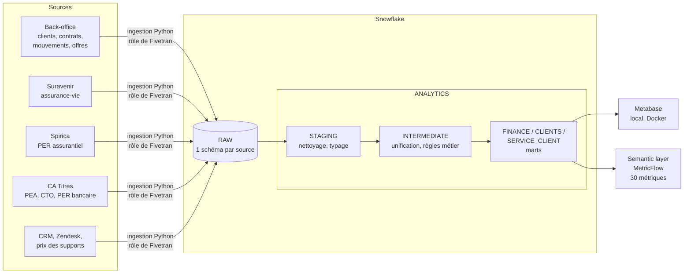

# Alto Analytics : plateforme analytique d'un gérant d'épargne en ligne


Projet d'**analytics engineering** de bout en bout pour une société de gestion d'épargne en
ligne de type robo-advisor (gestion pilotée 100 % ETF : assurance-vie, PER, PEA, compte-titres).

Il couvre la chaîne de données complète :
1. ingestion des fichiers de trois partenaires (assureurs et teneur de compte) ;
2. modélisation dbt sur Snowflake ;
3. semantic layer MetricFlow ;
4. dashboards Metabase en local.

> Les données sont **100 % synthétiques**. Leur structure et leurs règles métier reprennent
> l'offre publique de Yomoni (enveloppes, partenaires, profils P1 à P10, grille de frais,
> mécanique des offres promotionnelles). Voir [Les données](#les-données).

---

## Sommaire
- [Architecture](#architecture)
- [Ce que le projet démontre](#ce-que-le-projet-démontre)
- [Les données](#les-données)
- [Démarrage rapide (local, sans compte, 5 min)](#démarrage-rapide-local-sans-compte-5-min)
- [Exécution sur Snowflake](#exécution-sur-snowflake-essai-gratuit-30-jours)
- [Metabase en local](#metabase-en-local)
- [Modèle de données](#modèle-de-données)
- [Qualité et tests](#qualité-et-tests)
- [Structure du repo](#structure-du-repo)
- [Limites et pistes](#limites-et-pistes)

---

## Architecture



| Brique de la stack cible | Dans ce projet |
|---|---|
| Fivetran | `ingestion/` : générateur + chargeur Python qui reproduit les tables d'un connecteur Fivetran (colonnes `_fivetran_synced` / `_fivetran_deleted`, suppressions logiques, doublons de resynchronisation) |
| Snowflake | Bases `RAW` / `ANALYTICS`, rôles `LOADER` / `TRANSFORMER` / `REPORTER`, entrepôts XS, plafond de crédits, utilisateurs de service authentifiés par clé RSA (`snowflake/01_setup.sql`) |
| dbt (Cloud ou Core) | 40 modèles en 3 couches, seeds, snapshot, macros portables Snowflake/DuckDB, 83 tests de données + unit tests |
| Semantic layer MetricFlow | 6 semantic models, 30 métriques (simple, ratio, dérivée, cumulative), 2 saved queries |
| Metabase | Docker Compose local + 12 questions SQL versionnées + script qui crée le dashboard par API |
| dbt Docs, Confluence | Descriptions sur tous les modèles et colonnes clés, lineage via `dbt docs`, décisions dans `docs/architecture.md` |

---

## Ce que le projet démontre

**1. Unifier des sources hétérogènes.** Chaque partenaire livre ses fichiers dans son propre format :
- identifiants différents : `SV00001234`, `SP-3000123`, `CAT003000456` ;
- frais en colonnes, en lignes ou en centimes texte ;
- dates en texte ;
- frais prélevés le 5 du mois suivant.

La couche intermediate les rapproche du contrat de l'application et produit un format unique
(`int_valorisations_unifiees`, `int_frais_partenaires`).

**2. Fiabiliser les flux partenaires : rapprochement des frais.** Les frais contractuels sont recalculés chaque jour : encours UC de la veille × taux / 365, week-ends complétés, part en fonds euros exclue du mandat. Ils sont ensuite comparés aux frais prélevés, sur 100 % des contrats chaque mois. Le modèle `finance_rapprochement_frais` pose un diagnostic automatique :
- `taux_mandat_errone` : 0,80 % appliqué au lieu de 0,70 % ;
- `ligne_absente` ;
- `sur_prelevement` / `sous_prelevement`.

Sur les données générées, il retrouve les anomalies injectées avec très peu de faux positifs.

**3. Automatiser un processus finance : calcul des remboursements des offres.** Les offres
« jusqu'à N mois de frais remboursés » et les « primes » suivent les règles de leurs conditions générales :
- palier selon le versement initial net ;
- premier mois entier suivant la souscription ;
- plafond global ;
- perte du droit si les apports nets passent sous le palier ou si le contrat est clôturé.

`int_offres_droits` calcule chaque droit. `finance_offres_rapprochement` le compare aux paiements saisis à la main par les opérations (statuts `conforme`, `non_paye`, `doublon`, `paye_a_tort`, `ecart_montant`). `finance_offres_a_regulariser` est le fichier de travail qui remplace le tableur. Deux unit tests figent la règle.

**4. Répondre aux métiers.**
- `dim_clients` : segments d'encours (dont l'éligibilité au conseiller dédié dès 100 k€), équipement multi-enveloppes, canal, objectif.
- `clients_valeur` : modèle de valeur client.
- `clients_a_contacter` : liste d'appel des conseillers, avec un score de risque de départ explicable et ses motifs en clair.
- `fct_tickets` : service client.

**5. Une seule définition par indicateur.** L'encours est un stock (dernier jour de la période, jamais sommé). La collecte nette, les revenus nets de mandat et le taux de conversion sont définis une fois dans MetricFlow.

---

## Les données

Les données clients d'une fintech ne sont jamais publiques (secret professionnel, RGPD).
Le générateur `ingestion/generate_sources.py` produit donc un jeu **synthétique et cohérent**,
calibré sur des informations publiques :

| Repris de l'offre publique | Hypothèse de simulation |
|---|---|
| Assurance-vie chez Suravenir, PER assurantiel chez Spirica, PEA / CTO / PER bancaire chez Crédit Agricole Titres | Frais d'enveloppe PEA, CTO et PER assurantiel |
| 10 profils P1 à P10, PEA en P10 uniquement ; P3 ≈ 20 % actions / 20 % obligations / 60 % fonds euros, P6 ≈ 50 / 50, P10 = 100 % actions | Répartition fine entre ETF |
| Frais de mandat 0,70 %/an, non prélevés sur le fonds euros ; enveloppe assurance-vie 0,60 % ; PER bancaire 0,30 % | Rendements annuels des classes d'actifs (ordres de grandeur réalistes) |
| Versement initial minimum 1 000 € ; offres « 6 / 7 / 8 mois de frais remboursés dès 10 k / 25 k / 50 k €, plafond 500 € », primes 100 / 250 / 500 € | Noms et dates des codes promo, comportements clients |

Volume par défaut : ~6 000 inscrits, ~4 400 clients actifs, ~6 000 contrats, ~105 000 mouvements,
~4 millions de valorisations quotidiennes (2022 à octobre 2026), ~155 M€ d'encours en fin de période.
Le jeu reproduit les comportements réels attendus :
- croissance et saisonnalité des inscriptions (janvier, périodes promo) ;
- effet de seuil des versements aux paliers des offres ;
- pic de versements PER en décembre (déduction fiscale) ;
- rachats et baisses de profil pendant la baisse des marchés de 2022 ;
- désensibilisation automatique du PER en gestion à horizon ;
- contrats enfants ouverts par un parent.

Sources publiques utilisées pour le calibrage : [frais Yomoni](https://www.yomoni.fr/apprendre/frais/sortie),
[partenaires](https://www.yomoni.fr/partenaires-qonto), conditions d'offres
([YOM24](https://static.yomoni.fr/documents/cgv/CG+YOM24.pdf), [WELCOME](https://static.yomoni.fr/documents/cgv/CG+WELCOME.pdf)).
Le détail des hypothèses est documenté en tête de `ingestion/referentiel.py`.

---

## Démarrage rapide (local, sans compte, 5 min)

Tout le projet tourne aussi sur **DuckDB**, ce qui permet de l'évaluer sans compte Snowflake.
C'est ce que fait la CI.

```bash
git clone https://github.com/<votre-compte>/alto-analytics.git && cd alto-analytics
python -m venv .venv && source .venv/bin/activate        # Python 3.11+
make install
make all          # génère les données, dbt build (modèles + tests), semantic layer
make docs         # dbt Docs + lineage sur http://localhost:8080
```

Exemples de requêtes sur la semantic layer :
```bash
export DBT_PROFILES_DIR=.
mf query --metrics encours,part_uc,encours_moyen_par_client --group-by encours_ligne__enveloppe --start-time 2026-10-01
mf query --metrics collecte_nette --group-by metric_time__month,mouvement__enveloppe --start-time 2025-10-01 --end-time 2026-01-31
mf query --metrics nouveaux_clients,taux_conversion_inscription --group-by client__canal_acquisition --start-time 2026-01-01
```

---

## Exécution sur Snowflake (essai gratuit 30 jours)

Le guide détaillé est dans [`snowflake/README_SNOWFLAKE.md`](snowflake/README_SNOWFLAKE.md). En résumé :

1. **Créer le compte d'essai** sur signup.snowflake.com et noter l'identifiant `ORGNAME-ACCOUNTNAME`.
2. **Générer deux paires de clés RSA**, une pour dbt/chargement et une pour Metabase (commandes `openssl` dans le guide).
3. **Exécuter `snowflake/01_setup.sql`** dans une feuille Snowsight, en ACCOUNTADMIN, après y avoir collé les clés publiques.
4. **Configurer et lancer** :
   ```bash
   cp .env.example .env            # renseigner SNOWFLAKE_ACCOUNT
   make snowflake-check            # test de connexion
   make snowflake-all              # chargement RAW (~3 min) + dbt build + semantic layer
   make docs-snowflake             # dbt Docs sur Snowflake
   ```

Après le build, on obtient dans Snowflake :
- `RAW.RAW_*` : les sources brutes ;
- `ANALYTICS.STAGING`, `ANALYTICS.INTERMEDIATE` : les couches de transformation ;
- `ANALYTICS.FINANCE`, `ANALYTICS.CLIENTS`, `ANALYTICS.SERVICE_CLIENT` : les marts ;
- `ANALYTICS.REFERENTIEL` : les seeds ;
- `ANALYTICS.SNAPSHOTS` : l'historique des contrats.

Le même projet fonctionne avec **dbt Cloud** : connecter le repo, choisir Snowflake avec
l'authentification par paire de clés, puis définir `SNOWFLAKE_RAW_DATABASE=RAW` dans les variables
d'environnement de dbt Cloud.

---

## Metabase en local

Prérequis : Docker Desktop.

```bash
make metabase-up                  # Metabase + Postgres (métadonnées) sur http://localhost:3000
```

1. Ouvrir http://localhost:3000 et créer le compte administrateur.
2. *Admin > Bases de données > Ajouter une base > **Snowflake***, avec les paramètres suivants :
   - **Nom d'affichage** : `Snowflake ANALYTICS`
   - **Compte** : `ORGNAME-ACCOUNTNAME`
   - **Utilisateur** : `METABASE_SVC`
   - **Authentification** : *clé privée RSA*, fichier `keys/metabase_svc_rsa_key.p8`. Dans le conteneur, le dossier est monté sur `/keys/` ; il est aussi possible d'importer le fichier par l'interface.
   - **Entrepôt** : `REPORTING_WH`
   - **Base** : `ANALYTICS`
   - **Rôle** : `REPORTER`
3. Créer automatiquement les 12 questions et le dashboard « Pilotage épargne » :
   ```bash
   make metabase-bootstrap MB_EMAIL=vous@exemple.fr MB_PASSWORD='VotreMotDePasse'
   ```
   Les requêtes vivent dans `metabase/questions/*.sql`, versionnées dans git.
   Le script les crée ou les met à jour à chaque exécution.

Le dashboard regroupe :
- encours par enveloppe ;
- collecte brute, rachats et collecte nette ;
- pic PER de décembre ;
- revenus de mandat et coût des offres ;
- acquisition et conversion par canal ;
- encours par profil ;
- segments d'encours ;
- écarts de frais partenaires ;
- rapprochement des offres ;
- liste d'appel des conseillers ;
- tickets par catégorie.

---

## Modèle de données

| Couche | Modèles | Rôle |
|---|---|---|
| **staging** (18 vues) | `stg_app__*`, `stg_suravenir__*`, `stg_spirica__*`, `stg_ca_titres__*`, `stg_market__*`, `stg_crm__contacts`, `stg_zendesk__tickets` | 1 modèle par table source : renommage en français, typage, dédoublonnage Fivetran, suppressions logiques, pivot des formats longs |
| **intermediate** | `int_valorisations_unifiees`, `int_frais_partenaires`, `int_contrats_enrichis`, `int_profil_contrat_historique` (SCD 2), `int_mouvements_executes`, `int_frais_mensuels_contrats`, `int_apports_nets_mensuels`, `int_offres_droits`, `int_date_arrete` | Unification multi-partenaires et règles métier réutilisables |
| **marts / finance** | `fct_encours_quotidien` (incrémental), `fct_mouvements`, `fct_frais_mensuels`, `fct_offres_droits`, `finance_rapprochement_frais`, `finance_offres_rapprochement`, `finance_offres_a_regulariser` | Pilotage financier et contrôles |
| **marts / clients** | `dim_clients`, `dim_contrats`, `clients_valeur`, `clients_a_contacter` | Analyses clients, marketing, relation client |
| **marts / service_client** | `fct_tickets` | Service client |
| **seeds** | `partenaires`, `offres_paliers` | Référentiels maintenus par l'équipe data |
| **snapshot** | `snap_contrats` | Historique statut et profil des contrats |

Choix notables, détaillés dans [`docs/architecture.md`](docs/architecture.md) :
- **date d'arrêté** plutôt que `current_date`, pour que les calculs restent rejouables ;
- paramètres métier dans `vars:` ;
- SQL portable (macros `dbt.dateadd`, `dbt.datediff`, `adapter.dispatch` pour les différences de syntaxe Snowflake/DuckDB) ;
- l'encours traité comme un stock (`non_additive_dimension`).

---

## Qualité et tests

- **83 tests de données** : unicité, non-nullité, valeurs acceptées, relations, combinaisons uniques, montants positifs (tests génériques maison dans `tests/generic/`).
- **Unit tests dbt** sur le calcul des droits d'offres : palier, plafond, rupture de condition, prime.
- **Tests singuliers de garde-fou** : droits sous plafond, réconciliation staging et faits, références partenaires rattachées.
- **Sévérité graduée** : les contrats de clients effacés (RGPD) déclenchent un avertissement documenté, pas une erreur.
- **Fraîcheur des sources** (`dbt source freshness`) sur `_fivetran_synced`.
- **CI GitHub Actions** : génération des données, `dbt build` et validation MetricFlow à chaque push.

---

## Structure du repo

```
├── ingestion/            génération des données synthétiques + chargement Snowflake
│   ├── referentiel.py    règles métier de l'offre (produits, profils, frais, offres)
│   ├── generate_sources.py
│   └── load_to_snowflake.py
├── snowflake/            mise en place du compte (rôles, entrepôts, utilisateurs, budget)
├── models/
│   ├── staging/          1 dossier par source
│   ├── intermediate/
│   ├── marts/            finance, clients, service_client
│   ├── semantic/         semantic models + métriques MetricFlow
│   └── utilities/        calendrier (time spine)
├── seeds/  snapshots/  macros/  tests/  analyses/
├── metabase/             docker-compose, questions SQL, bootstrap API
├── docs/architecture.md  décisions de conception
└── Makefile              toutes les commandes (`make help`)
```

---

## Limites et pistes

- **Ingestion** : un vrai déploiement utiliserait Fivetran (ou dlt / Airbyte). Le chargeur recrée les tables à chaque exécution, sans incrémental.
- **Fonds euros** : le rendement est couru quotidiennement (en réalité, il est crédité une fois par an).
- **Pistes** :
  - orchestrer avec dbt Cloud jobs ;
  - ajouter des contrats de modèles (`contract: enforced`) sur les marts exposés ;
  - masquer les données personnelles par rôle (Snowflake masking policies) ;
  - mesurer l'usage des dashboards pour retirer ceux qui ne servent plus.

---

Projet personnel réalisé par Youssef Chaabi.
